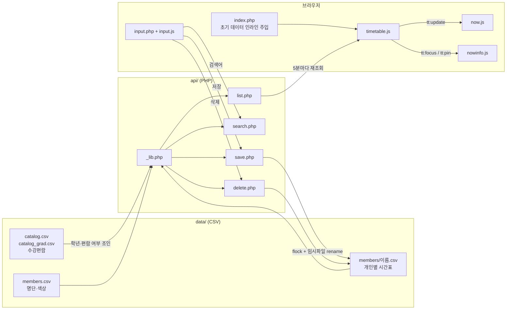

# Labs Timetable Dashboard (연구실 시간표)

연구실 구성원들의 수업 시간표를 한 화면에 겹쳐 보여 주는 웹 대시보드입니다.
"지금 누가 수업 중인가", "이 시간대에 모일 수 있는 사람은 몇 명인가"를 바로 확인하는 용도로 만들었습니다.

- 배포: <https://web.dcare.it.kr/~cksgdx/>
- 스택: PHP 8 (프레임워크 없음) · Vanilla JS · CSS · CSV 파일 저장소 (DB 없음)

---

## 1. 파일 구조

```
public_html/
├── index.php            # 대시보드 (조회 전용, 기본 진입점)
├── input.php            # 시간표 입력·수정·삭제 화면
├── api/
│   ├── _lib.php         # 공통 라이브러리: 경로·스키마·교시표·잠금·CSV 입출력·편람 파서
│   ├── list.php         # GET  전체 시간표 + 명단 + 현재 시각
│   ├── search.php       # GET  수강편람 과목 검색 (과목 → 교수 → 분반)
│   ├── save.php         # POST 수업 추가/수정 (group_id 단위)
│   ├── delete.php       # POST 수업 삭제 (group_id 단위)
│   └── index.html       # 디렉터리 목록 노출 방지용 빈 파일 (js/, css/에도 동일)
├── js/
│   ├── timetable.js     # 우측 시간표 그리드. 데이터·시각 상태의 소유자
│   ├── now.js           # 좌상단 "Now" — 지금 수업 중인 사람
│   ├── nowinfo.js       # 좌하단 "Now info" — 가리킨/고정한 칸의 수강 정보
│   └── input.js         # 입력 화면 로직 (편람 검색, 직접 입력, 미리보기)
├── css/
│   ├── style.css        # 대시보드 스타일
│   └── input.css        # 입력 화면 스타일
└── data/                # (gitignore) 개인정보 — 아래 4절 참고
```

## 2. 파이프라인



**조회 흐름**
1. `index.php`가 서버에서 전체 시간표를 읽어 JSON으로 페이지에 심어 둡니다. 첫 화면에 fetch 왕복이 없습니다.
2. `timetable.js`가 데이터와 현재 시각을 소유하고, 1분마다 다시 그리며 5분마다 `api/list.php`로 재조회합니다.
3. 좌측 패널(`now.js`, `nowinfo.js`)은 `CustomEvent`만 구독해 그립니다. 원본 행이 이미 메모리에 있으므로 추가 요청이 없습니다.

**입력 흐름**
1. 학부생: 편람 검색 → 교수 선택 → 분반 선택 → 요일·시간·강의실 자동 채움 → 저장
2. 대학원생·개인일정: 과목명 직접 입력 → 요일 체크 → 교시 또는 시각 선택 → 저장
3. `save.php`가 전 항목을 검증한 뒤 한 번의 잠금 안에서 파일을 통째로 교체합니다.

## 3. 주요 기능과 구현 포인트

### 대시보드 (`index.php`)
- **좌 40% / 우 60% 레이아웃.** 좌측은 Now와 Now info가 1:1로 나눕니다.
- **Now**: `start <= 현재 < end`인 수업을 요일·시각으로 필터링합니다. 주말에는 빈 상태가 됩니다.
- **Timetable**
  - 2명 이상 선택 시: 수업마다 반투명 박스를 겹쳐 그려, 겹칠수록 진해지는 히트맵이 됩니다.
  - 1명만 선택 시: 수강학년별 색(1~4학년·대학원·교양·개인일정) 블록에 과목·강의실·교수·시간을 표시합니다.
  - 구성원 칩으로 필터링하고, 선택 인원 중 해당 칸에 비어 있는 사람 수를 보여 줍니다.
  - 세로축은 5분 단위 선형 시간이지만 블록은 교시 밴드에 맞춰 그려, 교시 사이 쉬는 시간이 빈틈으로 남지 않게 했습니다.
- **Now info**: hover하면 임시로, 클릭하면 고정으로 해당 칸의 수강 정보를 나열합니다.

### 두 가지 교시 체계
이 학교는 50분제(0~15교시)와 75분제(A~G교시)를 함께 씁니다. 두 체계의 경계(예: 75분제 종료 10:15, 11:45)를 모두 표현하려면 5분 단위가 필요하므로 시간은 자정 기준 분 단위 정수로 저장합니다.

### 수강편람 파서 (`parse_class_time`)
편람의 강의시간 표기는 형식이 제각각입니다.

| 원문 | 해석 |
|---|---|
| `화5,6` | 화 13:00~14:50 (연속 교시 병합) |
| `화B,목B` | 화·목 10:30~11:45 |
| `월7,8/금7,8` | 월·금 15:00~16:50 |
| `화7,8,목9` | 화 15:00~16:50 + 목 17:00~17:50 (한 분반) |

쉼표가 "다음 교시"와 "다른 요일" 두 가지 뜻으로 쓰이므로, 구분자 대신 **요일 문자를 만날 때마다 묶음을 끊는** 방식으로 파싱합니다. 편람 한 행(= 한 분반)이 요일마다 다른 시각에 열리는 경우가 약 15%라서, 저장 단위를 `slots` 배열로 두었습니다.

### 검색 (`api/search.php`)
과목명의 대부분이 붙여쓰기이므로 공백 제거·소문자화한 문자열로 비교합니다. 결과는 과목 → 교수 → 분반으로 묶어 자동완성 목록이 같은 이름으로 도배되지 않게 했습니다.

### 저장 안정성
- **잠금**: 별도 `.lock` 파일에 `flock`. 교체 대상 CSV에 직접 잠그면 `rename()` 순간 잠금이 무의미해지기 때문입니다.
- **원자적 교체**: 임시 파일에 쓴 뒤 `rename()`. 쓰기 중 스크립트가 죽어도 파일이 반쯤 잘리지 않습니다.
- **읽기-수정-쓰기 단일 잠금** (`mutate_rows`): 같은 사람이 두 탭에서 동시에 저장해도 한쪽이 유실되지 않습니다.
- **묶음 단위 처리**: 주 N회 수업은 `group_id`로 묶어 한 번에 저장·삭제합니다. 월·수 중 하루만 남는 반쪽 상태를 막습니다.
- **전부 검증 후 기록**: 시각 범위, 5분 단위, 요청 내 자기 겹침을 모두 확인한 뒤에만 씁니다.

### 보안
- 구성원 이름이 곧 파일명이므로, 명단(`members.csv`) **화이트리스트 대조**로 경로 순회(`../`)를 차단합니다.
- 색상은 서버가 명단에서 채우며 클라이언트 값은 신뢰하지 않습니다.
- `index.php`에 심는 JSON은 `JSON_HEX_TAG | JSON_HEX_QUOT` 등으로 이스케이프해 `<script>` 탈출을 막습니다.
- 운영 서버에서는 `data/`를 웹 루트 바깥(`/home/cksgdx/data`)에 두고 절대경로로 접근합니다.
- 서버 `php.ini`에 시간대가 없어 `Asia/Seoul`을 코드에서 고정합니다. "지금 수업 중"을 계산하므로 시간대 오차는 곧 오답입니다.

### 수강학년 색상
학년은 CSV에 저장하지 않고 **조회할 때마다 편람에서 조인**합니다. 편람을 새로 올리면 기존 시간표에도 즉시 반영되고, 마이그레이션이 필요 없습니다. 편람의 학년 표기(`1`, `2,3,4`, `전체학년`, 빈칸 등)는 `1~4 / G(대학원) / ''(교양)`으로 정규화하고, 개인일정은 `P`로 구분합니다.

## 4. `data/` (저장소에 포함하지 않음)

구성원 실명과 시간표가 들어 있어 `.gitignore`로 제외했습니다. 구조만 적어 둡니다.

| 파일 | 내용 | 헤더 |
|---|---|---|
| `members.csv` | 구성원 명단과 표시 색상 | `name,color` |
| `members/{이름}.csv` | 구성원별 시간표. 한 행 = 한 요일의 한 수업 | `id,group_id,member,day,start,end,subject,prof,room,color,personal` |
| `catalog.csv` | 학부 수강편람 (읽기 전용, UTF-8 BOM) | `과목명,교수명,강의시간,강의실,학년` |
| `catalog_grad.csv` | 대학원 수강편람 (선택) | `과목명,교수명,강의시간,강의실,학년` |
| `.lock` | 쓰기 잠금용 빈 파일 | - |

- `day`: 0(월)~4(금)
- `start` / `end`: 자정 기준 분 (예: 540 = 09:00)
- `personal`: 개인일정이면 `1`, 아니면 빈칸

## 5. 실행 방법

PHP 8.1 이상이 필요합니다.

1. `api/_lib.php`의 `DATA_DIR`를 로컬 경로로 바꿉니다.
2. 위 표대로 `data/` 디렉터리와 `members/` 폴더를 만들고 웹 서버가 쓸 수 있게 권한을 줍니다. `members.csv`에는 구성원을 직접 등록합니다(명단에 없는 이름은 저장이 거부됩니다).
   ```csv
   name,color
   홍길동,#9FC7F5
   ```
3. 개발 서버 실행:
   ```bash
   php -S localhost:8000
   ```
4. <http://localhost:8000> 에 접속합니다.
